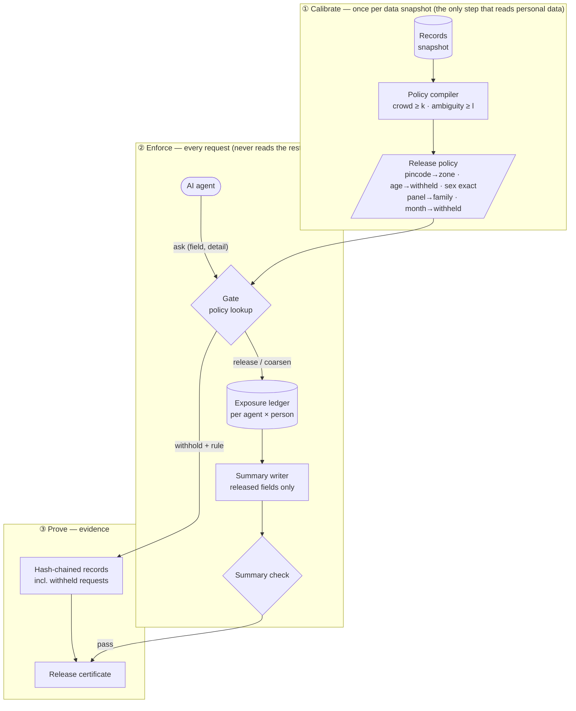

# GrainGate

**The right data, at the right grain.**

GrainGate is release control for AI agents that work with regulated
personal data: in banking and lending, insurance, healthcare, telecom,
HR or public services. It sits between an agent and your records, and
makes sure that whatever the agent asks, and however many times it asks,
it never gets enough detail to single out a person or learn a private fact
it wasn't cleared to see.

---

## The challenge

A health insurer's AI agent is reviewing a policy renewal. It's connected
to a diagnostic-lab network's data, with masking switched on: it never
sees names, phone numbers or patient IDs. It asks five questions about a
customer's recent lab visit, each one harmless on its own:

| # | Agent asks | Masked system answers | People still matching |
|---|---|---|---|
| 1 | Age? | 31 | many thousands |
| 2 | Sex? | Female | thousands |
| 3 | Pincode? | 560040 | a few dozen |
| 4 | Visit month? | March | a handful |
| 5 | Collection centre? | Vijayanagar | **one woman** |

No name was released, but the agent now knows exactly whose record this
is. Its next question, *"was anyone matching this profile hepatitis-B
reactive?"*, is really a question about her. A "yes" could mean a premium
hike or a refused renewal, decided on a test result she never agreed to
share with her insurer.

It can go wrong even sooner. If the only people matching her description
were referred by a liver clinic, the agent can guess her result without
identifying her at all. And a system that refuses only when an answer
would be identifying gives the game away with the refusal itself.

**Behind GrainGate**, the same five questions get *withheld*, *female*,
*Bengaluru West*, *withheld*, *withheld*:

- **Never fewer than k people.** In whatever order it asks, the agent is
  left with a crowd that never drops below a set size, *k*.
- **Results stay ambiguous.** Her test result stays hidden among at least
  *l* possible outcomes. It's released, at a coarse level only, if a
  permitted purpose applies, such as her documented consent.
- **Everything is logged.** Every answer, including every refusal, goes
  into a record that can't be edited afterwards.

*(The table is an illustration. The runnable demo below measures the same
effect on synthetic data.)*

## Where it applies

| Industry | Example agent | What must not leak |
|---|---|---|
| Banking & lending | Underwriting, collections, fraud review | Restructuring, defaults, income band |
| Insurance | Claims adjudication, renewal pricing | Claim history, medical disclosures |
| Healthcare & life sciences | Referrals, trial recruitment, lab results | Diagnoses, test results, therapies |
| Telecom | Customer-service and retention agents | Location history, call patterns |
| HR | Performance, payroll, benefits assistants | Disciplinary records, health leave |
| Public services | Eligibility and benefits agents | Welfare status, caste or category data |

It's built for regimes that demand evidence of anonymisation: India's
DPDP Act, GDPR, HIPAA, and sector rules in banking and insurance.

## Why masking fails

Masking removes names and IDs, then hands everything else over exactly.
That fails as soon as an AI agent is the one asking:

- **Harmless details add up.** Age, sex, pincode, the month of a visit,
  the centre it happened at: each is innocent alone. Together
  they usually point to one person.
- **Agents ask in pieces.** A filter that checks one message at a time
  never sees that the last five answers, combined, identify someone.
- **Small groups give secrets away.** If everyone matching a description
  has a restructured loan, or had a fertility test, you know the person's
  secret without knowing their name.

GrainGate controls the **grain** (the level of detail) of every field it
releases, keeps track of what each agent already knows, and refuses to
let the total ever narrow below a safe crowd.

## About this repository

This is a self-contained, dependency-free Python demo of how GrainGate
works. Any regulated dataset would do; the demo uses a **healthcare**
scenario (clinical-trial pre-screening on a synthetic diagnostic-lab
network) because health data has some of the hardest small-group cases.
The same engine applies unchanged to the other industries above: only the
fields and their detail ladders change.

## How it works



1. **Calibrate.** Once per data snapshot, the policy compiler studies the
   records and publishes a small **release policy**: the finest level of
   detail each field may ever be released at. The policy is chosen so that
   every possible combination of answers still leaves at least *k* people,
   and their private results stay spread over at least *l* possibilities.
2. **Enforce.** Each agent request gets one of three answers from the
   **gate**: *release*, *coarsen* (release at the safe level instead) or
   *withhold*. The gate decides from the policy alone, so every person
   gets the same decision for the same request, and a "withheld" says
   nothing about the person. The **exposure ledger** remembers what each
   agent has learned about each person, so asking in small pieces doesn't
   get around it.
3. **Prove.** Every decision, including every withheld request, is written
   to a tamper-evident hash chain. Outgoing text is written only from
   released fields and checked sentence by sentence. Each session produces
   a **release certificate** that a compliance team can check without
   seeing any personal data.

## Quick start

```bash
python cli.py demo                     # runtime is pure standard library
pip install pytest                     # tests only
python -m pytest tests/ -q             # 17 tests
```

Options: `python cli.py demo --n 12000 --k 20 --l 4 --seed 42 --out out`

---

## The demo scenario: trial pre-screening across a lab network

A pharmaceutical sponsor is recruiting for a women's-health trial. Its
**recruitment agent** (an AI agent run by the sponsor's research
organisation) pre-screens candidates across a diagnostic-lab network:
a chain of collection centres across Bengaluru.

The lab wants to help, but it must not let the sponsor identify anyone, or
learn anyone's test results, until that patient has consented. GrainGate
sits between the agent and the lab's records.

**Synthetic data only.** The demo generates 12,000 fictional lab patients
across 30 Bengaluru pincodes in 4 zones and 11 test panels. Two small
sensitive groups are planted on purpose, because that's where plain
masking fails:

| Planted group | Size | Where | What they share |
|---|---|---|---|
| Fertility testing (partner IVF clinic) | 120 (1%) | 3 East Bengaluru pincodes | All women aged 25–40, all with a Reproductive finding |
| Hepatitis screening (partner liver clinic) | 72 (0.6%) | 2 West Bengaluru pincodes | All with an Infectious finding |

Learning that someone is in one of these groups is the same as learning
their result.

### Fields and detail ladders

Each field has a ladder from exact (rung 0) to withheld (`*`). A coarser
rung is always a function of the finer one: a pincode always maps to the
same zone.

| Field | Kind | Rung 0 | Rung 1 | Rung 2 | Rung 3 |
|---|---|---|---|---|---|
| pincode | identifying | `560038` | `Bengaluru East` | `Bengaluru` | `*` |
| age | identifying | `26` | `20-29` | `*` | |
| sex | identifying | `F` | `*` | | |
| panel | identifying | `Fertility Panel` | `Specialised` (vs `Routine`) | `*` | |
| visit_month | identifying | `M09` | `Q3` | `*` | |
| finding | **private** | `Raised FSH` | `Reproductive` ← harm level | `*` | |
| therapy | **private** | `clomiphene` | `Fertility` ← harm level | `*` | |

The **harm level** is the coarsest rung at which a private field still
hurts if it leaks. Knowing "Reproductive" about someone is already
harmful, so GrainGate measures ambiguity at group level, not at the level
of the exact result.

### The demo patient

The demo follows the hardest case: the first patient in the fertility
group.

| Field | Value |
|---|---|
| patient_id | `L-00103` (never released) |
| age / sex | 26 / F |
| pincode | 560038 |
| panel / visit month | Fertility Panel / September |
| finding / therapy | Raised FSH / clomiphene |
| lab note | "Patient is a cab driver from 560038; measured value 8.9; sibling under treatment." (never leaves the lab) |

---

## Walkthrough: reading `python cli.py demo`

All numbers below come from the default run and can be reproduced from
the seed.

### 1. Sample data

```
12000 synthetic lab patients across 30 Bengaluru pincodes
planted sensitive groups: fertility testing 120, hepatitis screening 72
```

### 2. Release policy

```
published policy:
{ "floor": {"age": 2, "panel": 1, "pincode": 1, "sex": 0, "visit_month": 2},
  "k": 20, "l": 4, "private_release_allowed": true, "version": "rp-d45c735d090b" }
compiler stats: {'combinations_tried': 139, 'smallest_crowd': 28, 'least_ambiguity': 4, ...}
independent re-check: ok=True, smallest crowd=28, least ambiguity=4
```

The compiler tries every combination of rungs (4 × 3 × 2 × 3 × 3 = 216),
finest first, and keeps the first one that passes two tests:

- **Crowd test.** Group patients by their identifying fields at the floor
  *plus* their private fields at harm level. Every group must have
  ≥ k = 20 people. This is the worst case: the private fields have been
  released for a permitted purpose, which narrows the crowd.
- **Ambiguity test.** Group patients by identifying fields only. Every
  group must contain ≥ l = 4 different finding groups (and therapy
  classes). This is the case before anything private is released.

**What the floor means for an agent:**

| Field | Floor | Best the agent can get |
|---|---|---|
| pincode | 1 | the zone (`Bengaluru East`), never the pincode |
| age | 2 | nothing (withheld) |
| sex | 0 | exact |
| panel | 1 | the family (`Specialised`), never the panel |
| visit_month | 2 | nothing (withheld) |

**Why each field landed where it did.** The chosen floor is the only
passing combination at its level of coarseness. Relaxing any one field
breaks a test:

| Try instead | Fails | Why |
|---|---|---|
| exact pincode | crowd test: smallest group **2** | Fine on identifying fields alone (smallest group 48). But once findings can be released, e.g. *560070 · F · Specialised · Cardiovascular · Diuretic* holds just 2 people. |
| age band (`20-29`) | crowd test: smallest group **1** | Zone × sex × decade × panel family leaves single-person groups. |
| visit quarter (`Q3`) | crowd test: smallest group **5** | Same effect through the month field. |
| exact panel | ambiguity test: **1** finding group | The panel nearly decides the result: everyone with a Fertility Panel is Reproductive. |

**Where 28 and 4 come from:**
- The tightest crowd is *Bengaluru West · M · Specialised · Infectious ·
  Antiviral* (28 people), mostly the planted hepatitis group. That's still
  ≥ 20.
- The policy leaves 16 identifying groups. The least varied, e.g.
  *Bengaluru North · F · Specialised*, still spans exactly 4 finding groups:
  Cardiovascular, Hepatic, Oncologic and Renal.

The published policy carries only the floor, k, l and a version. The
per-group statistics stay with the operator.

### 3. Recruitment session

```
ask pincode      exact -> coarsen  rung= 1 value='Bengaluru East'  rule=rp-d45c735d090b/pincode/floor-1
ask age          exact -> withhold rung=-1 value=None              rule=rp-d45c735d090b/age/withheld
ask sex          exact -> release  rung= 0 value='F'               rule=rp-d45c735d090b/sex/ok
ask panel        exact -> coarsen  rung= 1 value='Specialised'     rule=rp-d45c735d090b/panel/floor-1
ask visit_month  exact -> withhold rung=-1 value=None              rule=rp-d45c735d090b/visit_month/withheld
crowd now: 638 patients; possible finding groups: 5 (l=4)
```

The agent asks for every identifying field exactly. The gate does one
lookup per request:

```
if the field is withheld by policy   -> WITHHOLD
elif requested rung >= floor         -> RELEASE
else                                 -> COARSEN  (release at the floor)
```

The patient's record is read only *after* the decision, to produce the
value. The `rule` points into the published policy, so the agent can see
why it got what it got.

After these five requests the agent knows *"a woman in East Bengaluru who
had a specialised test"*. **638** patients match:

| Panel | Patients | → finding group |
|---|---|---|
| Liver Function | 151 | Hepatic |
| Cardiac Markers | 137 | Cardiovascular |
| Kidney Function | 134 | Renal |
| **Fertility Panel** | **120** | **Reproductive** |
| Tumour Markers | 96 | Oncologic |

The patient is hidden among 638 people, and her result could be any of 5
groups.

**Private fields need a permitted purpose:**

```
ask private fields, purpose=marketing -> withhold (rp-d45c735d090b/private/purpose-not-permitted)
ask private fields, purpose=consented-prescreening -> release {'finding': 'Reproductive', 'therapy': 'Fertility'}
crowd after consented release: 120 patients (k=20; finding group now shared on purpose)
```

- Finding and therapy are released **together or not at all**, and only
  at harm level. They're released together because the therapy class
  nearly gives away the finding group, so releasing one alone would
  reveal both anyway.
- The purpose decision depends only on the purpose and the policy, never
  on the patient.
- After the consented release the crowd drops to **120**, the whole
  fertility group. That's still ≥ 20, because the policy's crowd test
  already assumed this release. The sponsor learns the group
  ("Reproductive"), never which of the 120 women it is, or the exact
  result.

**Timing:**

```
timing: gate decision 0.39 us; evidence record (hash-chained) 5.4 us
```

The decision itself is a dictionary lookup. Writing the hash-chained
evidence record is the more expensive part, so production deployments
write evidence asynchronously. Numbers vary by machine.

### 4. Linkage attack: plain masking vs GrainGate

The agent asks the same five exact questions. After each answer it keeps
only the patients consistent with *everything* it has learned.

```
step field         GrainGate  GG people  plain people  GG groups  plain groups
   1 age            withhold      12000           209         10            10
   2 sex             release       6162           111         10            10
   3 pincode         coarsen       1706             7          9             3
   4 panel           coarsen        638             5          5             1
   5 visit_month    withhold        638             1          5             1
```



**Plain masking:**

```
12000 patients
  └─ age = 26 ............................... 209   (10 finding groups possible)
      └─ sex = F ............................ 111   (10)
          └─ pincode = 560038 ...............   7   (3)
              └─ panel = Fertility Panel ....   5   (1: Reproductive)  ← result known
                  └─ month = September ......   1   ← person identified
```

- At step 4 the agent knows the result **before** it knows who the person
  is. Five people still match, so a simple head-count check wouldn't
  notice anything wrong.
- At step 5 one person is left: identified, with her fertility testing
  exposed.

**Behind GrainGate:**

```
12000 patients
  └─ age: withheld .......................... 12000
      └─ sex = F ............................  6162
          └─ pincode → Bengaluru East .......  1706
              └─ panel → Specialised ........   638  (5 finding groups)
                  └─ month: withheld ........   638  ← stops at the floor
```

No order of questions gets lower, because the compiler checked every
combination the policy allows. At every step the demo also confirms that
the agent's candidate list is exactly the crowd computed from the
exposure ledger alone, so the ledger is a complete record of what the
agent knows.

### 5. Safe summary for the sponsor

```
summary : Pre-screening summary: female candidate, from Bengaluru East, Specialised panel,
          finding group Reproductive, on Fertility therapy. Eligible for site contact.
check   : PASS
```

The summary is **written** from released fields only. Nobody tries to
scrub the lab note. The checker then reads the finished text back on its
own, without trusting the writer:

| Phrase found in text | Claim | Released rung | OK? |
|---|---|---|---|
| "female" | sex, rung 0, F | 0 | ✅ |
| "Bengaluru East" | pincode, rung 1 | 1 | ✅ |
| "Specialised" | panel, rung 1 | 1 | ✅ |
| "Reproductive" | finding, rung 1 | 1 | ✅ |
| "Fertility" | therapy, rung 1 | 1 | ✅ |
| everything else | template wording | — | ✅ |

```
leaky   : ... Patient is a cab driver, measured value 8.9, finding Raised FSH.
check   : REJECT
          - finding: 'Raised FSH': rung 0 is finer than released rung 1
          - text: unrecognised content: Patient is a cab driver measured value 8.9
```

A contaminated writer that peeked at the lab note is caught in two ways:

- **"Raised FSH"** is recognised as a finding, but at rung 0, which is
  finer than what was released.
- **The occupation and the measured value** aren't template wording or
  anything GrainGate recognises, so they're rejected as unrecognised
  content. The check is fail-closed: anything it doesn't recognise
  doesn't leave.

The same check blocks made-up facts: a claim with no ledger entry fails
exactly like a leaked one.

### 6. Release certificate

```json
{
  "policy_version": "rp-d45c735d090b",
  "parameters": {"k": 20, "l": 4},
  "released_rungs": {"pincode": 1, "sex": 0, "panel": 1, "finding": 1, "therapy": 1},
  "ledger_intact": true,
  "summary_check": "pass"
}
certificate hash verifies: True
```

The full `out/release_certificate.json` also carries the agent, the
patient reference, the ledger's head hash, the claims in the summary and a
timestamp, all bound under one SHA-256 hash. Editing any field breaks the
hash.

### 7. Checks

| Check | Shown by |
|---|---|
| Crowd never below k during the linkage attack | 638 ≥ 20 at every step (§4) |
| Crowd still ≥ k after consented private release | 120 ≥ 20 (§3) |
| Ledger matched the attacker's knowledge at every step | verified inside the attack loop (§4) |
| Same gate decisions for 200 different patients | decisions compared across a random sample |
| Finding stayed ambiguous before release | 5 groups ≥ 4 (§3) |
| Private fields withheld for a non-permitted purpose | `marketing` → withhold (§3) |
| Clean summary passed, leaky summary rejected | §5 |
| Ledger hash chain intact; certificate hash verifies | §6 |
| Policy re-verified against the data | §2 |

---

## Project layout

```
graingate/ladders.py       detail ladders for each field; Bengaluru zones,
                           panel families, finding groups, therapy classes
graingate/sample_data.py   synthetic lab network with planted sensitive groups
graingate/policy.py        offline policy compiler + independent re-check
graingate/gate.py          runtime gate (release / coarsen / withhold),
                           purpose check for private fields
graingate/exposure.py      exposure ledger + hash-chained evidence
graingate/summary.py       summary writer, claim extractor, summary check
graingate/certificate.py   release certificate build + check
demos/linkage.py           linkage attack: plain masking vs GrainGate
tests/test_graingate.py    17 tests, one per product property
docs/                      animation used in this README
cli.py                     end-to-end demo
```

## What this demo does not cover

This is a demo of the core idea, kept small on purpose:

- **One data snapshot, one agent per session.** Production handles data
  refreshes, agent identity and agents that share what they learn.
- **A single policy floor for every request.** Production policies can
  adapt to what an agent already knows, and set stricter limits for
  especially sensitive groups.
- **Template summaries.** Production can use an LLM to *plan* a summary,
  but GrainGate still renders and checks every word.
- **Aggregate statistics** (counts, averages) are a separate channel with
  their own protection and aren't part of this demo.
- **Out of scope:** what an agent already knows from outside sources, and
  agents colluding under different identities.

## License

The code is released under the [MIT License](LICENSE). Please read the
[NOTICE](NOTICE) file as well: the methods GrainGate implements are
**patent pending**, and the MIT License covers copyright only. It grants
no patent rights. Commercial or production use of the methods needs a
separate patent license.

GrainGate is developed by NeuroPearl AI Labs. Licensing enquiries:
support@nrlabs.ai
